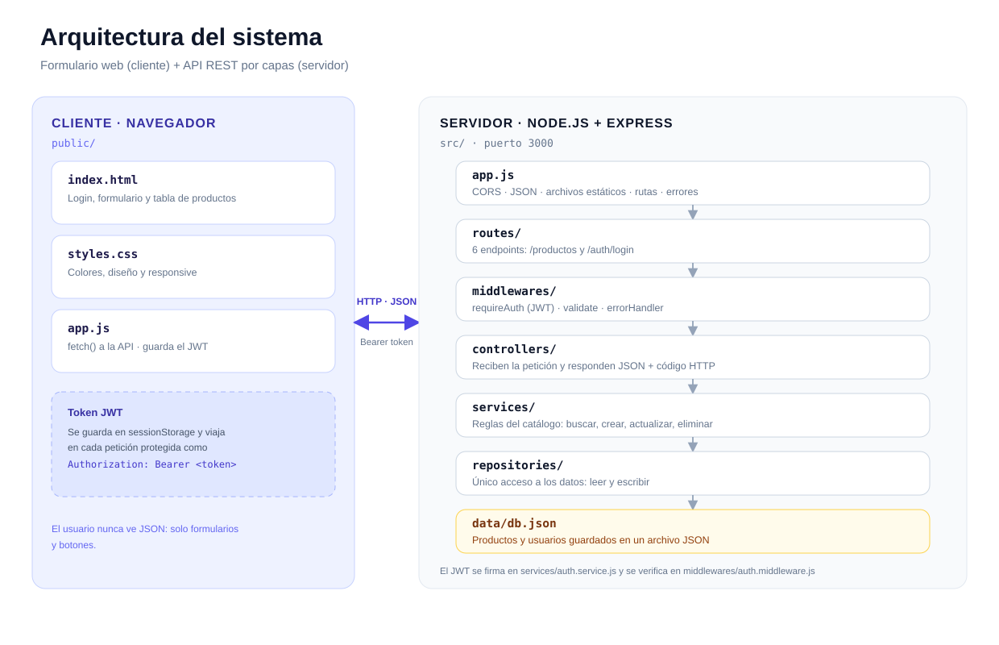
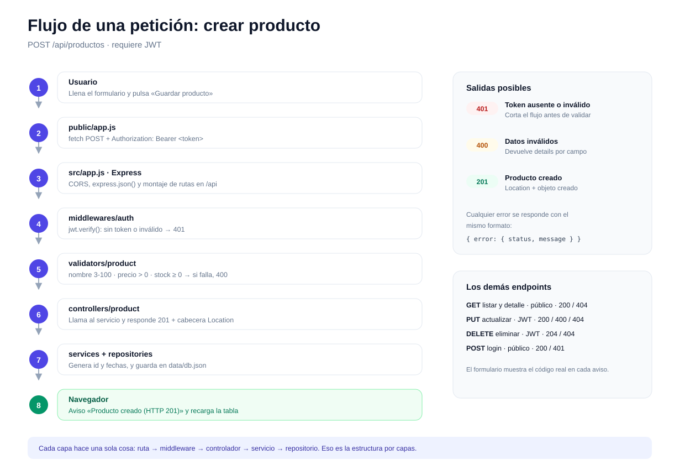

# API REST - Catálogo de Productos

Actividad práctica del Módulo 3: API REST con CRUD de productos, autenticación JWT,
CORS, validación de datos, códigos HTTP correctos y estructura por capas.

## Demo en línea

- **Aplicación:** <https://sistema-crud-7vpc.onrender.com>
- **Repositorio:** <https://github.com/victoor-cyber/SISTEMA-CRUD>

> Las credenciales del administrador en producción se definen con las variables
> `ADMIN_EMAIL` y `ADMIN_PASSWORD` del servicio en Render.
> El plan gratuito duerme la app tras 15 minutos sin visitas: la primera carga
> puede tardar hasta un minuto.

## Tecnologías

- Node.js 20+ (probado con Node 24)
- Express 4
- JSON Web Token (`jsonwebtoken`) + `bcryptjs`
- `express-validator` para validación de entradas
- `cors`
- Persistencia en archivo JSON (`data/db.json`) sin base de datos externa

## Requisitos del enunciado

| Método | Ruta | Acceso | Implementado en |
|---|---|---|---|
| GET | `/api/productos` | Pública | `product.routes.js` |
| GET | `/api/productos/:id` | Pública | `product.routes.js` |
| POST | `/api/productos` | JWT | `product.routes.js` + `auth.middleware.js` |
| PUT | `/api/productos/:id` | JWT | `product.routes.js` + `auth.middleware.js` |
| DELETE | `/api/productos/:id` | JWT | `product.routes.js` + `auth.middleware.js` |
| POST | `/api/auth/login` | Pública | `auth.routes.js` |

Extras incluidos: `GET /api/health`, `GET /api/auth/me`, paginación, búsqueda,
filtros y ordenamiento.

## Puesta en marcha

> En este equipo PowerShell bloquea `npm.ps1`, por eso los comandos se ejecutan
> con `npm.cmd`. Si prefieres usar `npm`, ejecuta una vez:
> `Set-ExecutionPolicy -Scope CurrentUser RemoteSigned`

```powershell
# 1. Instalar dependencias
npm.cmd install

# 2. Arrancar el servidor (crea data/db.json y el usuario admin la primera vez)
npm.cmd start

# 3. Modo desarrollo con recarga automática
npm.cmd run dev
```

Servidor: <http://localhost:3000>

### Credenciales iniciales

```
email:    admin@tienda.com
password: Admin123!
```

Se pueden cambiar en el archivo `.env` (`ADMIN_EMAIL`, `ADMIN_PASSWORD`);
solo se aplican al crear la base de datos por primera vez.

## Formulario web (CRUD visual)

Además de la API, el proyecto incluye un **formulario web** servido por el mismo
Express, en la raíz: <http://localhost:3000>

- **Login** con email y contraseña → guarda el JWT en `sessionStorage`.
- **Crear**: llenar el formulario y pulsar *Guardar producto* (`POST`).
- **Listar**: tabla con los productos, contador, búsqueda y botón *Actualizar* (`GET`).
- **Editar**: botón ✏️ de la fila → el formulario se llena y cambia a modo edición (`PUT`).
- **Eliminar**: botón 🗑️ con confirmación (`DELETE`).
- Muestra avisos con el **código HTTP** real de cada operación y los mensajes de
  validación que devuelve la API.
- Si el token expira (401), cierra la sesión automáticamente y pide login de nuevo.

Archivos: `public/index.html`, `public/styles.css`, `public/app.js`.
Captura de referencia: `docs/captura-formulario.png`.

## Variables de entorno (`.env`)

| Variable | Por defecto | Descripción |
|---|---|---|
| `PORT` | `3000` | Puerto del servidor |
| `JWT_SECRET` | `super-secreto-cambiar-en-produccion` | Clave para firmar los tokens |
| `JWT_EXPIRES_IN` | `2h` | Vigencia del token |
| `CORS_ORIGIN` | `*` | Orígenes permitidos (`*` o lista separada por comas) |
| `DB_FILE` | `data/db.json` | Archivo de persistencia |
| `ADMIN_*` | ver `.env.example` | Usuario creado en el primer arranque |

## Flujo de uso

1. Abrir <http://localhost:3000> y entrar con el usuario de prueba.
2. Usar el formulario para crear, editar y eliminar productos.
3. Alternativamente, consumir la API directamente:
   `POST /api/auth/login` → token → `Authorization: Bearer <token>` en las rutas protegidas.

### Ejemplos

**Login**

```bash
curl -X POST http://localhost:3000/api/auth/login \
  -H "Content-Type: application/json" \
  -d '{"email":"admin@tienda.com","password":"Admin123!"}'
```

**Listar productos (público, con filtros)**

```bash
curl "http://localhost:3000/api/productos?page=1&limit=5&search=mouse&sort=precio&order=asc"
```

**Crear producto (JWT)**

```bash
curl -X POST http://localhost:3000/api/productos \
  -H "Content-Type: application/json" \
  -H "Authorization: Bearer $TOKEN" \
  -d '{"nombre":"Camara web Full HD","precio":149900,"stock":15,"categoria":"Perifericos"}'
```

**Actualizar producto (JWT)**

```bash
curl -X PUT http://localhost:3000/api/productos/ID_DEL_PRODUCTO \
  -H "Content-Type: application/json" \
  -H "Authorization: Bearer $TOKEN" \
  -d '{"precio":279900,"activo":false}'
```

**Eliminar producto (JWT)**

```bash
curl -X DELETE http://localhost:3000/api/productos/ID_DEL_PRODUCTO \
  -H "Authorization: Bearer $TOKEN"
```

## Contrato de la API

### Respuestas exitosas

```json
// 200 - GET /api/productos
{
  "data": [ { "id": "...", "nombre": "...", "precio": 0 } ],
  "meta": { "total": 4, "page": 1, "limit": 10, "totalPages": 1, "hasNextPage": false, "hasPrevPage": false }
}

// 201 - POST /api/productos
{
  "message": "Producto creado correctamente",
  "data": { "id": "...", "nombre": "...", "precio": 0, "createdAt": "...", "updatedAt": "..." }
}

// 200 - POST /api/auth/login
{
  "message": "Inicio de sesion exitoso",
  "data": {
    "token": "eyJhbGciOi...",
    "tokenType": "Bearer",
    "expiresIn": 7200,
    "user": { "id": "...", "nombre": "Administrador", "email": "admin@tienda.com", "rol": "admin" }
  }
}
```

### Respuestas de error

```json
{
  "error": {
    "status": 400,
    "message": "Los datos enviados no son validos",
    "details": [ { "campo": "precio", "mensaje": "El precio debe ser un numero mayor que 0" } ]
  }
}
```

### Códigos HTTP utilizados

| Código | Cuándo |
|---|---|
| `200` | Consulta, actualización o login exitoso |
| `201` | Producto creado (incluye cabecera `Location`) |
| `204` | Producto eliminado (sin cuerpo) |
| `400` | JSON inválido o datos que no pasan la validación |
| `401` | Token ausente, inválido o expirado; credenciales incorrectas |
| `403` | Origen no permitido por CORS |
| `404` | Ruta o producto inexistente |
| `413` | Cuerpo de petición demasiado grande |
| `500` | Error interno no controlado |

### Modelo de producto

| Campo | Tipo | Reglas |
|---|---|---|
| `id` | string | UUID generado por el servidor |
| `nombre` | string | Obligatorio, 3 a 100 caracteres |
| `descripcion` | string | Opcional, máximo 500 caracteres |
| `precio` | number | Obligatorio, mayor que 0 |
| `stock` | integer | Opcional, mayor o igual a 0 (por defecto 0) |
| `categoria` | string | Opcional, 2 a 60 caracteres (por defecto `General`) |
| `activo` | boolean | Opcional (por defecto `true`) |
| `createdAt` / `updatedAt` | string | ISO 8601, generados por el servidor |

Parámetros del listado: `page`, `limit` (1-100), `search`, `categoria`, `activo`
(`true`/`false`), `sort` (`nombre`, `precio`, `stock`, `createdAt`, `updatedAt`) y
`order` (`asc`/`desc`).

## Estructura por capas

```
public/                      Formulario web (frontend) que consume la API
  index.html                 Login + formulario CRUD + tabla de productos
  styles.css                 Estilos y diseño responsive
  app.js                     Lógica: fetch, JWT, crear/editar/eliminar
src/
  app.js                     Configuración de Express (CORS, JSON, rutas, errores)
  server.js                  Arranque del servidor y seed inicial
  config/env.js              Variables de entorno centralizadas
  routes/                    Definición de endpoints (capa de rutas)
    index.js
    product.routes.js
    auth.routes.js
  controllers/               Traducen HTTP <-> servicios (capa de control)
    product.controller.js
    auth.controller.js
  services/                  Reglas de negocio (capa de servicio)
    product.service.js
    auth.service.js
  models/                    Entidades y campos permitidos (capa de modelo)
    product.model.js
  repositories/              Acceso a datos (capa de repositorio)
    product.repository.js
    user.repository.js
  middlewares/               Auth JWT, validación, errores, logs
  validators/                Reglas de express-validator
  database/                  Almacén JSON y datos iniciales
  utils/                     Utilidades (AppError, asyncHandler)
tests/
  api.test.js                Pruebas de integración (node:test)
docs/
  api.http                   Colección para la extensión REST Client
  postman_collection.json    Colección de Postman
  captura-formulario.png     Captura del formulario funcionando
data/
  db.json                    Datos (se crea automáticamente)
render.yaml                  Configuración de despliegue en Render
DEPLOY.md                    Guía de publicación gratuita
```

## Pruebas

### Automatizadas

```powershell
npm.cmd test
```

Usan `node:test` (incluido en Node) con `fetch`, levantando la app en un puerto
aleatorio y una base de datos temporal. Cubren login, CRUD, validaciones, JWT, CORS
y que el formulario web se sirva en la raíz (26 pruebas en total).

### Colecciones manuales

- **Postman / Thunder Client / Insomnia:** importar `docs/postman_collection.json`.
  Ejecutar primero *Login (guarda el token)*: el token y el `productoId` se guardan
  automáticamente en las variables de colección.
- **VS Code (REST Client):** abrir `docs/api.http`, hacer login, copiar el token en
  la variable `@token` y ejecutar las peticiones en orden.

## Diagramas

**Arquitectura del sistema** (cliente + servidor por capas):



**Flujo de una petición** (crear un producto con JWT):



También están en PNG para Word/PowerPoint: `docs/diagrama-arquitectura.png` y
`docs/diagrama-flujo.png`.

## Publicar en la web (gratis)

Guía paso a paso en **[DEPLOY.md](DEPLOY.md)**: GitHub + Render (plan gratuito),
variables de entorno, comprobaciones y alternativas.

Resumen:

1. Subir el proyecto a un repositorio de GitHub.
2. En Render: **New + → Web Service**, Build `npm ci`, Start `npm start`.
3. Configurar `JWT_SECRET`, `ADMIN_EMAIL`, `ADMIN_PASSWORD` y `NODE_ENV=production`.
4. Listo: HTTPS y URL pública gratis.

El repo incluye `render.yaml` para desplegar automáticamente con un Blueprint.

> En el plan gratuito el disco es temporal: `data/db.json` se reinicia al
> redesplegar. Para persistencia real, conectar MongoDB Atlas o PostgreSQL
> cambiando solo la capa `src/repositories/`.

## Relación con la rúbrica

| Criterio | Peso | Dónde se evidencia |
|---|---|---|
| CRUD completo y funcional | 30 % | `public/` (formulario visual) + `src/routes/product.routes.js`, `src/services/product.service.js`, `src/repositories/product.repository.js` |
| Validación y códigos HTTP | 20 % | `src/validators/*`, `src/middlewares/error.middleware.js`, pruebas de 400/401/404/201/204 |
| CORS y JWT | 20 % | `src/app.js` (cors), `src/middlewares/auth.middleware.js`, `src/services/auth.service.js` |
| Estructura por capas | 15 % | Carpetas `routes/controllers/services/repositories/models` |
| Colección de pruebas | 15 % | `docs/postman_collection.json`, `docs/api.http`, `tests/api.test.js` |

## Notas

- Las contraseñas se guardan con hash `bcrypt`, nunca en texto plano.
- El almacenamiento en JSON es suficiente para la actividad; `repositories/` aísla
  la persistencia para poder migrar a SQL/Mongo sin tocar servicios ni controladores.
- `data/db.json` se regenera con los datos de ejemplo si se elimina el archivo.
